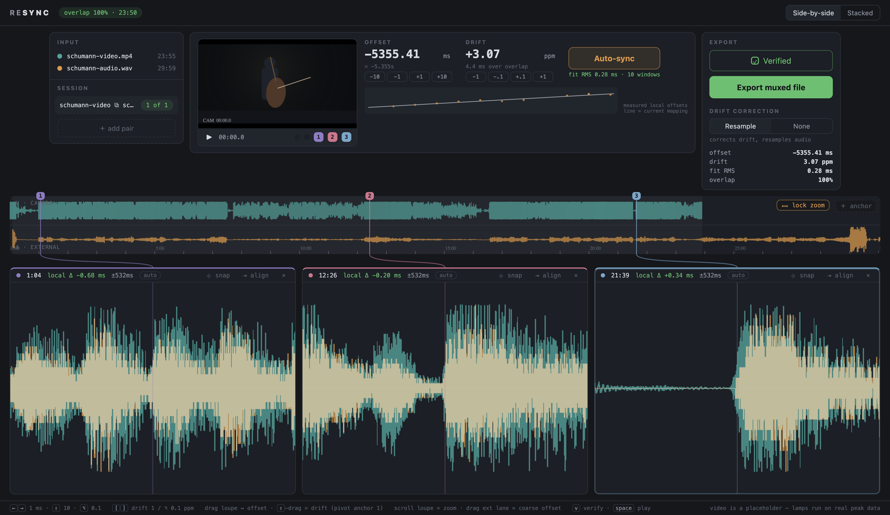
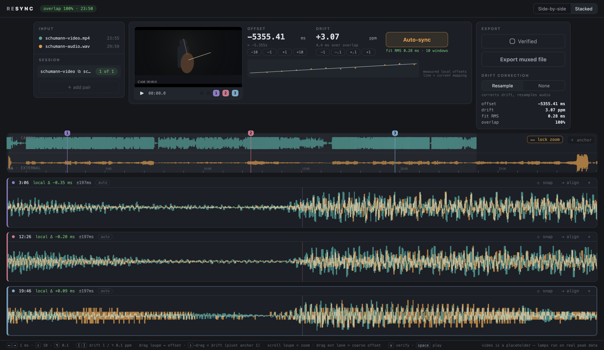
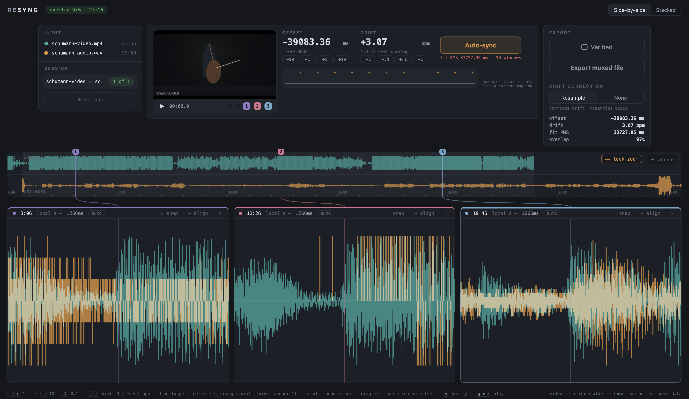

# UX-DECISIONS.md

**Project:** Couple
**Purpose of this document:** Definitive UX handoff for the technical-spec session. The spec session has not seen the interactive mockups or the design conversation; this document stands alone. It records what was *decided*, what the engine must therefore *provide*, and what remains *open*. Where the document gives concrete numbers (window sizes, thresholds, timings), treat them as validated starting values, not sacred constants, unless marked DECIDED.

**Provenance, briefly:** The design went through three deliberately opposed interactive HTML mockups (editor-centric, queue-centric, inspector-style), then converged through three feedback iterations against **real recording data** — a 23.9-minute concert video (camera audio, AAC, heavily AGC-limited) and a 30-minute external recorder WAV. All sync algorithms described in §4 were implemented in the mockups and validated against that real pair: global offset −5354.74 ms recovered from a cold start, drift +3.07 ppm measured with 0.276 ms RMS across 12 windows, total compute ~0.6 s in single-threaded JavaScript. Engine requirements below are therefore demonstrated, not speculative.

**What the app is:** A focused macOS desktop utility that syncs one externally recorded audio file to one video file (replacing the camera audio), with automatic waveform cross-correlation, drift (sample-rate mismatch) measurement and optional correction, and a manual verification UI built around multiple simultaneous magnified waveform views ("loupes") pinned to different timestamps — so the user never scrolls or re-zooms to check alignment at the start, middle, and end of a recording.

**v1 scope (DECIDED):** Single-pair editor. A lightweight session queue for multiple takes per session is the defined v2 direction (§2.6), with only a minimal placeholder affordance in v1. The editor is the product; the queue is an accelerator once the editor is proven. The keys `j`/`k`/`Enter` are reserved in the keymap for v2 queue triage and must not be bound to anything else in v1.

---

## 1. CHOSEN DESIGN

### 1.1 Paradigm

A single-window **workbench**. The verification-first single-pair editor is the entire v1 product surface; a multi-pair session queue is a defined v2 direction (§2.6) with only a minimal placeholder in v1. The window reads top-to-bottom as the workflow: **Input → Sync → Export** across a compact strip at the top, with the **waveform stage** owning all remaining (and all flexible) space below.

The defining design element: a full-width **overview strip** showing both complete tracks, with colored, draggable **anchor pins**, connected by colored leader lines to a row of **loupes** — live magnified views of both waveforms overlaid at each anchor. Every alignment adjustment (keyboard nudge, drag, automatic fit) updates all loupes simultaneously in real time. The user verifies sync at three points at once instead of zoom-scroll-zooming through the file.


*(The two loupe layouts: [side-by-side](design/mockups/side-by-side-view.png), [stacked](design/mockups/stacked-view.png). All mockup screenshots are structural reference, not a pixel spec — see design/mockups/README.md.)*

### 1.2 Window layout (DECIDED)

Four horizontal bands, top to bottom:

1. **Title/top bar** (intrinsic height): app wordmark; a live **overlap chip** ("overlap 99% · 23:50", or amber "no alignment"/"no overlap"); right-aligned segmented control for loupe layout (**Side-by-side | Stacked**).
2. **Workflow strip** (intrinsic height; max content width ~1340 px, centered when the window is wider): three columns — Input (~222 px), Sync (flexible, ≥500 px), Export (~230 px). Panels size to their content; nothing in this strip stretches to fill vertical space.
3. **Waveform stage** (all remaining height, flexible): overview strip, connector layer, loupes.
4. **Footer** (intrinsic height): one line of keyboard-shortcut reminders plus a note that the lamps/preview run on real peak data.

Resize policy (DECIDED): the waveform stage is the only greedy region. Minimum window ~1000 × 560; below that the window scrolls rather than crushing the waveforms. Extra width goes entirely to the waveform stage (the workflow strip caps and centers); extra height goes entirely to the loupes. No region may ever produce dead filler space when the window grows.

### 1.3 Input panel

Two file rows — camera and external — each with a color identity dot (camera = teal, external = amber, used consistently everywhere in the app), the filename, and the decoded duration. Below a divider, a single **session row** showing the pair name (file basenames joined) and a "1 of 1" position chip, plus a dashed **"+ add pair"** affordance.

In v1, "+ add pair" opens a new pair, replacing the current one after an unsaved-changes confirmation. It is a real affordance, not a stub — its purpose is enabling multiple-take sessions without quitting the app — but it does not add a persistent queue or list view. That is v2. (See §2.6 and §6.11 for details.)

Design note carried from feedback: pair identity must not depend on filenames being descriptive — real-world inputs are often `MVI_0012.MP4` + `ZOOM0007.WAV`. Durations are always shown; the v2 queue adds video thumbnails for the same reason.

### 1.4 Sync panel (the editor's control center)

Left: a small **video preview** (16:9, ~264 px wide, intrinsic height — never letterboxed into leftover space) with a transport bar: play/pause, timecode, two **transient lamps** (camera-transient and external-audio-transient indicator dots; see Open Questions §6.2 for whether these survive once real playback exists), and one small colored **jump button per anchor** that starts playback ~0.8 s before that anchor.

Right, two rows:

- **Row 1 — readouts and the primary action.** Three groups: **Offset** (editable numeric, ms, 2 decimals, signed; a small sub-line shows the human-readable form "= −5m 21.355s" when |offset| ≥ 1 s; nudge buttons −10/−1/+1/+10 ms), **Drift** (editable numeric, ppm, 2 decimals; sub-line shows projected end-to-end ms over the overlap, or "off — measured X ppm" when correction is disabled; nudge buttons −1/−0.1/+0.1/+1 ppm; the whole group is visually disabled when drift-correction mode is None), and the **Auto-sync** button (the panel's visually primary element; shows live progress percentage while running) with a **fit status** sub-line beneath it: "fit RMS 0.28 ms · 10 windows", color-coded green < 0.7 ms, amber < 3 ms, red above; "not measured" before any sync.
- **Row 2 — drift sparkline.** A small (~46 px tall, horizontally flexible, gracefully compressible) plot: measured per-window local offsets as dots (opacity encodes measurement confidence) against camera time, with the **current mapping** (offset + drift line) drawn through them. This is deliberately peripheral — a glanceable "do my measurements agree with my line" check, not a hero element. It doubles as a fitting aid: when the line threads the dots, the mapping matches the measurements.

There is intentionally **no "fit" button** and **no per-loupe match percentage** (both existed in earlier iterations and were removed — see §2.4 and the rationale notes inline).

[SCREENSHOT not captured: sync panel close-up with drift mode None / greyed drift group. The sync and export panels are visible — with Resample selected — in design/mockups/01-full-window-post-sync.png; for the None state (greyed drift group, "X ms uncorrected" summary line) the text above is the only reference.]

### 1.5 Export panel

Top to bottom: **Verified** toggle (checkbox-style button, keyboard `v`); **Export** button (visually inert until Verified; clicking while unverified explains the gate); **Drift correction** segmented control — **Resample | None** — with a one-line helper ("corrects drift, resamples audio" / "audio untouched (offset only)"); a small summary grid: offset, drift (shows "X ms uncorrected" when mode is None and drift was measured), fit RMS, overlap %.

The drift-mode control is not a passive export flag (DECIDED, and important): selecting **None zeroes drift in the live mapping**, so the loupes and audition show exactly what an offset-only export produces — the far-end loupe's local Δ honestly displays the uncorrected drift. The measured ppm is retained and restored when switching back to Resample. Any manual drift edit while in None mode flips the mode to Resample (editing a value you've chosen not to apply is a contradiction the UI resolves automatically).

### 1.6 Waveform stage

**Overview strip** (~96 px, full width): two stacked lanes — camera (teal, top) and external (amber, bottom) — drawn over the **union** of both tracks' extents in video-time coordinates, so partial overlap is immediately visible as lanes that don't fully cover each other. The external lane is drawn through the current offset/drift mapping and therefore slides live as offset changes. The overlapping region gets a subtle background highlight. Minute tick marks with sparse labels run along the bottom. Lane labels "V · CAMERA" / "A · EXTERNAL" sit at the lane corners. A thin playhead line appears during playback. Two floating chips sit top-right: **"lock zoom"** (toggle, default on) and **"+ anchor"**.

**Anchor pins:** one per anchor, a small numbered flag in the anchor's identity color (a fixed palette of four hues distinct from teal/amber) with a stem line down through both lanes. Pins are draggable along the overview; on release the pin **snaps to the nearest strong transient** (±4 s search). Pin colors match the corresponding loupe's accent everywhere (flag, loupe border, leader line, jump button).

**Connector layer:** colored bezier leader lines from each pin down to the top-center of its loupe — **side-by-side layout only** (DECIDED: in stacked layout connectors crossed the content and are omitted entirely; the color-matched labels carry the association).

**Loupes:** 2–4 (default 3), in either a single row of equal columns (side-by-side) or full-width stacked rows (stacked; full width trades the at-a-glance connectors for maximum horizontal alignment precision — both layouts ship, side-by-side is the default; DECIDED). Each loupe:

- Header: identity dot · anchor time · **local Δ** ("local Δ +0.19 ms", color-coded green |Δ| < 0.7 ms, amber < 3 ms, red above, grey "—" when no confident measurement) · window size ("±120ms") · **auto** chip (lit when the window is auto-framed) · spacer · **⌖ snap** · **⇥ align** · **×** remove.
- Canvas: both tracks' min/max peak bands drawn **overlaid** at the same center line with additive ("screen") blending so overlap literally brightens; **stepped per-bin rendering** (DECIDED — honest pixels; smoothing/interpolation exists as a deferred render-style option, §5); **per-loupe local normalization** — each track independently scaled so its in-window peak fills ~86% of half-height (DECIDED, and necessary: the camera track is AGC-limited while the external preserves dynamics; no global gain makes them comparable in every passage, local gain does); a vertical center line in the anchor color; during playback, a playhead in the focused loupe.
- **Residual guidance arrow:** when the measured local Δ exceeds ~12% of the window, an amber arrow is drawn from center toward where the matching external content sits, labeled with the distance ("ext content → 38.6 ms") — the user always knows which way and how far, never lost off-screen.


*(Stacked layout reference. Not captured in any screenshot: the residual guidance arrow and the drift-mode-None loupe state — the text above is the only reference for those.)*


*(Closest capture to the pre-sync marker: a badly misaligned mapping (offset ≈ −39 s, 87% overlap) with visibly disagreeing loupes. The true virgin state — offset 0, "no alignment" chip — was not captured; the §1.2 chip description and the §3 state definitions are authoritative.)*

---

## 2. INTERACTION PATTERNS

### 2.1 Alignment model (DECIDED — single source of truth for all math)

State: `offsetMs` (resolution 0.01 ms) and `driftPpm` (resolution 0.01 ppm). Mapping from video time *t* (seconds, camera timeline) to external-file time *u*:

```
u(t) = t · (1 + driftPpm·1e−6) + offsetMs/1000
```

The **local lag** at video time *t*, in ms: `L(t) = offsetMs + t · driftPpm·1e−3`. A per-window *measured* local lag λ(t) (engine-supplied, §4.3) has the same units/sign; the per-anchor residual displayed as "local Δ" is `λ(tᵢ) − L(tᵢ)`. Positive Δ means the matching external content currently appears to the *right* of the camera content by Δ ms.

Sign intuition: increasing offset shows later external content at the same video time, i.e. external waveform features move left.

### 2.2 Anchors

- **Auto-proposal** (on load and after every auto-sync): automatic anchors must **always lie inside the current video/external overlap** — an anchor outside the overlap has no corresponding content in one lane and is not honest evidence. The count is decided on **usable overlap duration**, NOT the camera clip's total duration (REVISED 2026-06-15, TODO-011 — the old "falls back to the camera duration when overlap is unknown/short" rule placed anchors where the external source had no content; removed):
  - **Overlap ≥ 30 s** ⇒ three anchors at the *sharpest attack* inside each of three zones — [1%, 30%], [38%, 62%], [70%, 99%] of the **overlap** span. "Sharpest attack" = highest onset score from the engine's ranked onset list (§4.5). Validated on the real recording: all three picks were attacks out of near-silence (envelope ~20–60 → ~180–240 of 254).
  - **0 < usable overlap < 30 s** ⇒ **two** well-separated, human-readable anchors chosen from the ranked onsets (sharpest first as the proxy for a clear shape), each non-degenerate (non-silent structure in **both** mapped lanes), kept **≥ ~25% of the overlap** apart, preferably one earlier / one later. Not arbitrary fractions or midpoints.
  - **No usable overlap** (or two non-degenerate candidate windows can't be found) ⇒ **zero** automatic anchors and the **manual-rescue state** ("place anchors manually"). Never a misleading midpoint. This preserves the core invariant: the automatic set is either **zero or 2–4** anchors (never exactly one).
- **Manual placement:** drag a pin along the overview (live loupe update while dragging); on release it snaps to the strongest transient within ±4 s. **⌖ snap** in a loupe header re-snaps in place. Rationale (DECIDED early and load-bearing): anchors on silence or sustained tones are unjudgeable — a held cello note is near-periodic and can alias a full cycle; transients are the only honest evidence.
- **Add/remove:** "+ anchor" adds the best unused **usable** onset **inside the overlap** keeping ≥8% of-overlap separation, capped at 4 (TODO-011: automatic "+ anchor" never chooses an onset outside the overlap; it adds nothing when none qualifies); anchors keep chronological order; minimum 2. Each loupe header has ×. (A deliberate **manual** anchor drag may still leave the overlap — only the automatic paths are bounded.)
- Moving or re-snapping an anchor invalidates and re-runs that anchor's local measurement.

### 2.3 Loupe windows: auto-framing and zoom lock

- Default window 240 ms (DECIDED after testing 40/80 ms against real 0.5 ms-resolution data — tighter defaults were both too blocky and contextless).
- **Auto-frame:** a loupe in auto mode sizes its window to `max(240 ms, 5 × |local Δ|)` (rounded to 10 ms, capped 2 s). Purpose: after a coarse sync, the far-end loupe shows the drift as a *visibly-sized* displacement of two recognizable shapes — never "so far out of frame I don't know the direction." Auto-framing re-applies on load, auto-sync, anchor move, and ⇥ align — **not** on every nudge (zoom changing mid-nudge is disorienting; DECIDED).
- **Zoom lock** (toggle on the overview, **default ON**; DECIDED): all loupes share one scale. Scroll-zoom on any loupe zooms all; an offset drag therefore moves identical pixel distances in every loupe. Under lock, auto-framing computes each loupe's desired window and applies the **maximum** to all. Manual scroll-zoom exits auto mode (for all loupes under lock, for one loupe unlocked); clicking the **auto** chip re-arms (all loupes under lock). Toggling lock on unifies windows to the current maximum.

### 2.4 The nudge/alignment workflow (the heart of the app)

Everything below updates **live, every frame**: all loupe canvases, the overview's external lane, both readouts, the sparkline's mapping line, and each loupe's displayed local Δ (recomputed against cached measurements; the *measurements themselves* are re-run on a ~450 ms debounce whenever the mapping has moved > 30 ms from a measurement's center, and on commit of typed values).

**Offset adjustments:**

- Plain **drag on any loupe canvas**: slides offset; ms-per-pixel = window/width, so drag sensitivity follows zoom. Direction: content follows the pointer.
- **Coarse drag on the overview's external lane** (lower half of the strip): offset at overview scale (seconds per pixel) — the ballpark/rescue gesture for grossly unaligned pairs.
- **Keyboard:** ←/→ = 1 ms; with ⇧ = 10 ms; with ⌥ = 0.1 ms.
- **Nudge buttons** ±10/±1 ms; **typed value** in the readout (Enter/blur commits).

**Drift adjustments:**

- **⇧-drag on a loupe** = *pivot drift drag* (DECIDED, a signature interaction): rotates the mapping line about the **reference anchor** — anchor 1 (the leftmost), or the rightmost when dragging anchor 1 itself — so the reference loupe's alignment is held fixed while the dragged loupe moves; intermediate loupes follow proportionally. Math: for pointer delta δ ms at anchor *i* with reference *r*: `Δslope = δ/(tᵢ−t_r)` ms/s; `driftPpm += Δslope·1000`; `offsetMs −= t_r·Δslope`. Guarded when |tᵢ−t_r| < 5 s.
- **⇥ align** (per loupe): one click zeroes that anchor's measured Δ using the same pivot math (plain offset shift when the anchor *is* the reference). Canonical two-click manual flow: align anchor 1, align anchor 3, anchor 2 confirms.
- **Keyboard:** [ / ] = 1 ppm; with ⌥ = 0.1 ppm. Buttons ±1/±0.1 ppm; typed value.
- Any drift edit while drift-correction mode is None flips mode to Resample (§1.5).

**Per-anchor evidence:** local Δ in ms with the green/amber/red thresholds of §1.6, the in-canvas guidance arrow, and the single **global** metric — fit RMS over the measured windows — under the Auto-sync button. Removed by explicit decision: a per-loupe "match %" (Pearson over visible pixels) — it changed with zoom and anchor position, i.e. moved when nothing meaningful changed; residuals in ms are the domain-true metric, with one global RMS for "overall fit."

### 2.5 Pair lifecycle: proposed → verified

1. **Load** both files → tracks decoded/peak-extracted → anchors proposed → **auto-sync runs automatically** (DECIDED: the app opens in an already-aligned state with the result clearly marked unverified; users who distrust the auto-sync result still have the full manual toolkit, and genuine failures still exercise the rescue flow). Drift-correction mode is auto-suggested on completion (§6.3).
2. **Inspect:** glance at three loupes (green Δs, visibly interleaved waveform texture), optionally nudge/pivot/align, optionally audition (§2.7), optionally watch the video preview at each anchor via the jump buttons. A toast on open reports offset, ppm, end-to-end ms, window count, RMS, and the suggested mode. Status is *unverified* until the user toggles Verified regardless of confidence.
3. **Verify:** toggle Verified (`v`). Export becomes active.
4. **Export** (§2.8).

Manual rescue path (auto-sync failed or distrusted): dismiss the failure toast → coarse-drag the external lane until the lanes roughly coincide → loupes start finding content → drag/nudge at anchor 1 → ⇧-drag or ⇥ align at the far anchor → verify.

### 2.6 Session and queue

**v1 (DECIDED):** single pair at a time. "+ add pair" in the Input panel opens a new pair, replacing the current one after an unsaved-changes check. Auto-sync runs on load (§2.5). "1 of N" position chip counts pairs opened in the current session (informational only — no persistent list in v1).

**v2 direction (documented so the spec can leave room; NOT v1 scope):** a left-rail session list in the style of the queue-centric mockup. Drag a folder of files in; the app proposes video+audio pairings via recording timestamps from metadata, verified or supplemented by cross-correlation peak across candidate pairs (envelopes already computed at import, so all-pairs comparison is cheap for ~3–6 takes). Each row shows a thumbnail, both filenames, duration, an auto-sync **status chip** (synced + residual ms / low-confidence / failed), a confidence bar, and an **inline verified checkbox** so high-confidence pairs can be cleared without opening the editor. Keyboard triage: `j`/`k` move through rows, `v` verifies and advances to the next unverified, Enter opens the editor. "Needs attention first" sort floats failures up. "Export all verified (n)" batch button. Explicitly NOT multicam timeline reconstruction.

### 2.7 Audition (DECIDED)

Three monitor modes, selectable in the editor:

- **Pan L/R** — camera audio hard left, external hard right; gross errors audible as inter-ear echo.
- **Overlay** — both tracks summed to mono at matched loudness; the user listens for flange/comb-filter/doubling artifacts, which sweep and vanish as alignment improves. (The musician's natural test.)
- **Null** — external polarity-inverted and summed with camera at matched loudness; the user tunes for *minimum* residual. Important caveat to surface in UI copy: with different microphones/positions/AGC the null is a relative dip, never silence.

Playback starts from the focused anchor (or any anchor via the jump buttons), shows playheads in the overview and focused loupe, and **always applies the current offset sample-accurately**. Drift is applied as a *rendered* correction: the audition region is (re)resampled after a drift change is committed — **not** live varispeed while dragging (DECIDED: "listenable after I've applied a drift adjustment" is the requirement; this materially simplifies the engine). When drift-correction mode is None, audition plays offset-only — matching what export will produce.

`space` toggles play/pause. Loudness matching for Overlay/Null uses per-track gain derived from the engine's level analysis.

### 2.8 Export

Gated on Verified. Produces, per the "standard, few core options" decision:

1. **Muxed video** (primary): video stream copied untouched into the same container family as the input; audio replaced by the aligned external track, trimmed/padded to the video timeline, offset applied sample-accurately, resampled only when drift mode is Resample. Option (single checkbox, default **off** — Open Question §6.7): retain the original camera audio as a second, default-muted track.
2. **Aligned WAV** (secondary): the external audio rendered to the video's timeline (same trim/offset/drift treatment) at the source sample rate — for users finishing in an NLE/DAW.

Codec/container details (PCM vs AAC defaults per container, bitrate) are delegated to the spec session with the guidance: PCM where the container allows (MOV), high-bitrate AAC otherwise; one visible choice at most.

### 2.9 Complete keyboard and pointer reference (as currently decided)

| Input | Action |
|---|---|
| ← / → | Offset −/+ 1 ms |
| ⇧ ← / ⇧ → | Offset −/+ 10 ms |
| ⌥ ← / ⌥ → | Offset −/+ 0.1 ms |
| [ / ] | Drift −/+ 1 ppm |
| ⌥ [ / ⌥ ] | Drift −/+ 0.1 ppm |
| v | Toggle Verified |
| space | Play / pause audition and preview |
| drag loupe | Offset (ms/px = window/width) |
| ⇧-drag loupe | Drift, pivoting on reference anchor (§2.4) |
| scroll on loupe | Zoom (all loupes when zoom-locked) |
| drag external lane in overview | Coarse offset (s/px scale) |
| drag anchor pin | Move anchor; snaps to nearest transient on release |
| Enter (in numeric field) | Commit typed offset/drift |
| j / k / ⏎ | *Reserved* for v2 queue triage (row nav / open) |

Typed-field focus suppresses the global shortcuts. All shortcuts also exist as visible controls; the footer shows the cheat line.

---

## 3. STATES (described in words; deliberately not mocked)

**Empty / launch.** No pair loaded. A single load surface: drop zone + two pickers (camera/video, external/audio), each slot showing its status independently. In the native app this should accept the *media files themselves* (video + WAV), not pre-extracted peak data — peak extraction is the engine's job (§4.1). User can do nothing else until both slots fill; the rest of the window may be hidden or inert.

**Import in progress.** Per-slot progress ("decoding audio… / building peaks…"). Cancellable per slot. Auto-sync begins automatically once both slots complete.

**Auto-sync running on load.** Auto-sync button shows progress ("Searching 43%…", then "Measuring drift…"); alignment inputs disabled; cancellable (Esc or clicking the button again), returning to the unaligned unverified state.

**Success.** Toast with the numbers; mode suggested; anchors proposed and green; fit status green. State is *unverified* — user must toggle Verified.

**Low-confidence result.** Heuristics in §4.9. UI: overlap chip or fit status in amber; toast says the result needs review; anchors with weak local measurements show grey "—" Δ; the user's tools are exactly the normal ones (move anchors to better transients, audition, manual nudge). Verified is never auto-set; low confidence simply means the human checks harder.

**Failed sync.** No statistically plausible correlation peak (or overlap below minimum). The mapping is left at zero (no half-applied guess); a toast explains, and the manual rescue path (§2.5) is the recovery. Drift reported "not measurable" when fewer than 3 windows pass the confidence gate.

**Unpaired / mismatched files.** v1: one slot filled — the load surface simply waits, with the empty slot highlighted. A same-kind file dropped twice replaces with confirmation.

**No overlap (user-induced).** If manual offset pushes the tracks apart, the overlap chip turns amber "no overlap", loupes show one-sided silence, measurements all read "—". Nothing breaks; dragging back recovers.

---

## 4. CORE ENGINE REQUIREMENTS (all validated in the mockups against real data unless noted)

### 4.1 Peak pyramid / waveform data

- Engine ingests the actual media (video container + audio file), decodes audio as **mono, 48 kHz, float**, and builds a min/max **peak pyramid** per track. Levels used by the UI: **24, 96, 480, 2400, 9600, 48000 samples/bin** (0.5 ms → 1 s). Values stored as int8 −127..127 with a per-track `normalization` (track absolute peak).
- The UI's universal read API: `band(t0, t1, nColumns) → {mins[], maxs[]}` — per-column min/max over an arbitrary time range, selecting the **coarsest level still yielding ≥ nColumns bins**, aggregating when bins exceed columns. Loupes call it at ~0.05–2 ms/px; the overview at ~1–2 s/px. Must be cheap enough to call for every loupe on every animation frame (the mockups redrew 3–4 loupes + overview at 60 fps during drags).
- **Resolution requirement discovered on real data:** the 24 samples/bin (0.5 ms) floor is visibly blocky below ~±60 ms windows. Provide **a finer base level (≤ 8 samples/bin, ≈0.17 ms)** *or* a raw-sample window fetch near anchors for deep zoom. (Open Question §6.5 covers which.)
- **Format:** the mockups transported peaks as JSON (~22–24 MB/track, ~4× binary size, multi-second parse). The native engine should use a binary representation internally; JSON interchange is not a requirement.
- Per-track **level statistics** for display gain: the UI's overview gain rule is `1.44 / p95(active envelope bins)` where active = bins > 12% of the track max at the 9600 level (plain percentiles fail: long silent tails skew them — observed). Loupes additionally re-normalize locally per view (§1.6); the engine just needs to expose envelope stats or the raw data to compute them.

### 4.2 Global auto-sync (offset search)

Hierarchical normalized cross-correlation over **log-compressed envelopes** (`log1p(max−min)` per bin). This design and all parameters below are **validated against real data** and supersede any earlier algorithmic suggestions:

- Stage 1: 9600 spb (0.2 s bins), full lag range ±(both durations), minimum overlap 20 s. **Selection by significance score `z = ncc·√(overlapBins)`, not raw NCC** — empirically mandatory: on the real pair, raw NCC picked a spurious 42-second-overlap peak at the lag boundary (ncc 0.83, z 12) over the true 99.6%-overlap alignment (ncc 0.88, z 75). Log compression further strengthened the true peak.
- Refinement stages at 2400/480/96/24 spb over shrinking spans (±500/±80/±14/±3 ms), plain NCC, **parabolic sub-bin interpolation** at each stage.
- Measured performance: ~0.6 s single-threaded JS for a 24 min × 30 min pair; native will be faster. **Progress callbacks** needed during stage 1 only; the whole operation must be **cancellable**.
- Outputs: offsetMs, coarse and fine confidence (NCC values) for status heuristics.

### 4.3 Windowed local-lag measurement (powers local Δ, drift, sparkline, ⇥ align)

`measureLocal(tc, halfWin, centerMs, spanMs) → {lagMs, ncc} | null`: NCC of a window of camera envelope (~16–20 s) against the external, searching lags `center ± span` at 96 spb then refining ±3 ms at 24 spb, parabolic sub-bin. Real-data accuracy: window-to-window RMS 0.276 ms (sub-bin). Called: per anchor (span ±80 ms, centered on current L(t)) on anchor move and on a ~450 ms debounce after mapping changes > 30 ms; and for the **drift pass**: 12 windows spread over the overlap, **reject ncc ≤ 0.4**, least-squares `(t, λ)` → offset + slope (`ppm = slope·1000`), requiring ≥ 3 accepted windows. Each call must run in low single-digit ms (it's invoked interactively).

### 4.4 Least-squares fit

`fitLS(points) → {offMs, ppm, rmsMs}` over `(t, lagMs)` pairs. Used by auto-sync's drift pass; RMS feeds the global fit-status readout, recomputed in UI against the *current* mapping whenever offset/drift change.

### 4.5 Onset ranking (anchor proposal and snap)

From the 480 spb envelope: score = (20 ms rise)² / (preceding level + 0.15·max), threshold rise > 10% of max, skip 1 s at each file edge, 0.3 s non-max suppression, ranked list (cap ~4000). Queries: best onset in [a, b] (zone proposal); best within ±4 s of t (snap). Validated to pick attacks-from-silence over loud-passage wiggles on the real recording.

### 4.6 Mutable alignment state (the document the UI reads/writes)

```
{ offsetMs (0.01 ms resolution), driftPpm (0.01 ppm),
  driftMode: 'resample' | 'none', savedDriftPpm,
  anchors: [seconds], frames: [{winMs, auto}], lockZoom,
  perAnchorMeasurements: [{lagMs, ncc} | null],
  driftWindows: [{t, lagMs, ncc}],
  verified: bool, loupeLayout: 'grid' | 'stack' }
```

Every mutation is observable by the renderer the same frame. (Persistence across launches: Open Question §6.8.)

### 4.7 Playback / audition interface

- Decode and play the **actual video** with the external audio mapped through current offset (sample-accurate) — replacing the mockup's placeholder canvas. Playback is **shell-side** (AVPlayer/AVFoundation on macOS); the engine supplies only the aligned audio per the established core/shell playback boundary. Seek to arbitrary video time; per-anchor cue points.
- Three monitor matrices: pan L/R; mono overlay sum with per-track loudness matching; null (polarity-invert external + sum, loudness-matched).
- Drift handling: **offline/streamed re-render of the audition region after a drift commit** — realtime varispeed is explicitly *not* required (DECIDED). When driftMode = none, play offset-only.
- Optional but cheap and useful if real playback is delayed in development: envelope values + onset events at a given time (this powered the mockup's meters/lamps).

### 4.8 Export pipeline

Per §2.8: video stream copy; aligned-audio render (trim/pad to video timeline, sample-accurate offset, optional resample for drift — the resampler must be transparent-quality since the no-resample mode exists specifically to protect audio quality); optional second (camera) audio track; standalone WAV render. Progress + cancellation for the export job.

### 4.9 Status heuristics (initial values — tune against more material in Session C)

Observed on the validated run: true alignment had coarse NCC 0.88 / fine (24 spb) NCC 0.67 / 10 of 12 drift windows accepted / RMS 0.28 ms. These values come from one recording pair; expect tuning once the real-data test corpus grows. Suggested chips: **synced** = fine NCC ≥ 0.5 and ≥ 6 windows and RMS < 1 ms; **low-confidence** = found but below that; **failed** = no peak with z above noise floor or overlap < 20 s.

**Drift-correction auto-suggest (DECIDED heuristic):** suggest Resample when the measured end-to-end drift (|driftPpm| × overlapSeconds / 1000) exceeds 2 ms; suggest None otherwise. This decides on the directly measured quantity rather than a proxy like clip duration. The 2 ms threshold is an open question (§6.3); the *form* of the heuristic is decided.

---

## 5. EXPLICITLY DEFERRED (do not re-litigate in the spec; these belong to the native implementation)

- All visual styling: exact palette values (the *semantic* color mapping of §1.3/§1.6 is decided), typography, spacing, panel chrome, dark/light themes, app icon.
- Animation/transition treatments; toast vs native notification styling.
- The HTML loader card — the native app uses standard open/drag-drop flows (§3 describes the states, not the chrome).
- Waveform **render style options**: stepped per-bin is the decided default; interpolated contours and max-contour outlines were prototyped and may return as a user preference. Not a v1 feature.
- Exact pixel dimensions in §1 (informative, not normative) — except the resize *policy* and minimum-size principle, which are decided.
- Mock-specific scaffolding that must not leak into the spec as features: the procedural fake video scene, simulated meters, JSON peak interchange.

---

## 6. OPEN QUESTIONS (decide before or during spec; nothing below was silently resolved)

1. **App name:** Couple (DECIDED — working title "Resync" retired).
2. **Transient lamps:** mockup scaffolding for "does sync *look* right" — once real A/V playback exists, keep them as a feature beside the preview, or drop? UI copy should note that human A/V-skew perception bottoms out around 40–80 ms, so the video preview alone catches only gross errors.
3. **Drift-correction auto-suggest threshold:** currently end-to-end > 2 ms → Resample. Plausibly should be frame-relative (e.g. half a frame duration) or content-dependent (music tolerates more than dialogue).
4. **Status thresholds** (§4.9): initial values are observational from one recording pair; need tuning across more material.
5. **Sub-ms zoom data:** finer pyramid base level (≤ 8 spb) vs on-demand raw-sample fetch near anchors — pick one (or both) in the spec.
6. **Pivot reference:** always anchor 1 (current) vs user-selectable pivot anchor.
7. **Export defaults:** keep-camera-audio-as-second-track default (currently off); codec defaults per container; whether the WAV export is always offered or opt-in.
8. **Persistence:** session/alignment state across launches (document format? auto-save? "recent pairs"?) — never discussed.
9. **Anchor cap:** 4 was a mockup convenience; confirm or raise.
10. **Nudge step sizes:** 1 / 10 / 0.1 ms and 1 / 0.1 ppm felt right in testing but were never explicitly ratified.
11. **"+ add pair" v1 behavior (DECIDED):** replace current pair with unsaved-changes check. Does "1 of N" chip persist across app launches or reset to 1 of 1 on relaunch? Related to §6.8 (persistence).
12. **Auto-run auto-sync on load (DECIDED):** yes — app opens already-aligned, result marked unverified.

---

*End of v1 document.*

---
---

# PART V2 — Queue-centric redesign (UX-DECISIONS-V2)

**Provenance.** This part was written from the **converged Session G mockup**
(`design/mockups-v2/`, the same real-data interactive-HTML method that produced
Part v1 — see the top-of-document provenance note and `design/mockups/`). Rows
1–4 of the mockup are the owner's real `multifile-session` resolved by the
Phase-7 engine (`couple pair`/`sync`/`peaks`); the design was iterated with the
owner over seven rounds on 2026-06-12 and declared converged that day.

**Precedence.** Per SPEC-V2 §0, this part is the UX authority for v2 behavior
and takes over from SPEC-V2's interim charter. **Part v1 above remains binding
for everything v2 does not change** — the single-pair editor's interaction
semantics, the alignment math (§2.1), anchors/loupes mechanics (§2.2–2.3), the
nudge/pivot workflow (§2.4), audition (§2.7), export internals (§2.8), the
engine requirements (§4). v2 demotes the v1 editor to a per-couple drill-down;
it does not rewrite how that editor works once open. Session-D/E owner
SPEC-CHANGEs (no anchor snap-on-drag, content-relative arrows, sync never
disturbs a seen view, uniform-height panels, raw-sample loupe rendering, ⌥ for
coarse drag) carry forward unchanged — see also the standing owner UX prefs in
project memory.

**Format.** Same DECIDED / owner-decision convention as Part v1. Cosmetic detail
(exact spacing, dot size, colors, label wording) is explicitly NOT specified
here — those are app-side polish (the v1 precedent: the owner re-judged many
mockup-"DECIDED" visuals once the real shell existed). What is fixed below is
behavior, structure, and vocabulary.

## V2.0 The product (DECIDED, owner)

The product is **many-takes triage**, not single-pair verification. Drop a
session's files; the app auto-pairs and auto-syncs; the user walks the resulting
**couples**, approving the good ones and fixing the rest; one action exports
everything approved. The v1 verification editor is correct and kept — it becomes
the drill-down a couple opens into, not the front door. Attention weights
(SPEC-V2 §1) are realized as visual weight: queue ~25%, video hero ~30%,
export ~20%, waveforms ~20%, sync tools ~5%.

**"Couple" is the user-facing noun (DECIDED, owner).** A row = one video + its
selected audio source + an alternates list. The app's name is literal: it
couples audio to video. Used in copy throughout.

## V2.1 Shell layout (DECIDED)

Three columns, no modal screens — **everything is visible at once; there is no
"editor screen" you navigate to and back from**:

1. **Queue rail** (left, ~25%): session header, the couple list in workflow
   sections (§V2.2), the media pool (§V2.6).
2. **Center**: the **video hero** (top, greedy), the waveform stage (overview +
   sync-tools panel), and a **persistent tool bar pinned to the bottom**
   (§V2.4).
3. **Export rail** (right, ~20%): destination, naming, format, the export
   button, per-couple export status (§V2.5).

- **Both side rails are drag-resizable** (owner); the center absorbs the slack.
- The video hero is greedy for height; the waveform stage is bounded (carries
  the v1 §1.2/Session-D resize policy: video absorbs extra height, waveforms
  stay compact).
- **Aspect ratio is inviolable** (owner): the video letterboxes, never
  distorts, under any layout change (binding for Session H — the mockup's
  canvas redraw is not the contract).

## V2.2 The queue (DECIDED)

- **Three workflow sections, not a sort control** (owner — supersedes SPEC-V2
  §11.3's "sort by needs-attention?"): **QUEUED FOR EXPORT** (approved) /
  **TO APPROVE** (good, unapproved) / **TO FIX** (questionable or no-match).
  Couples migrate between sections live as they are approved or repaired. Empty
  sections stay visible (dimmed, with counts) so movement is legible, not
  appearing/vanishing chrome.
- **Each couple shows**: video thumbnail, video filename, selected-audio
  filename, a coverage strip, a quality dot, an approve checkbox.
- **Coverage strip (DECIDED, owner)**: a thin amber bar **under the thumbnail**
  on every couple, showing the span of the video timeline the audio covers.
  Amber because amber is the external-audio identity color (so it reads as
  audio, not a playhead); consistent on all couples (full coverage = full bar).
  Coverage is a fact about the recording — it is **never** a quality penalty.

## V2.3 Quality = the verdict model (DECIDED, owner — settles §11.3 vocabulary)

Pairing quality is **three categories, not a continuous score**: **good /
questionable / none**. Rationale (owner + Phase-7 data): fit is bimodal for
same-source audio — it either locks (consistent drift line) or never converges;
the only real middle ground is *two takes of the same piece*, which means "a
human must choose," i.e. the questionable bucket. So:

- **Indicator = a single status dot** in the verdict color: filled green
  (good), filled red (questionable), hollow grey (none). A short **word rides
  along only when action is needed**: "pick one" (ambiguous), "forced"
  (below-floor manual), "no audio" (no match). Good couples show just a dot.
- **Match strength (z) is NOT shown on couples** — bimodality makes a strength
  meter false precision (rounds 1–4 tried a tick meter; dropped). Raw z lives
  in the tooltip only.
- **Relative strength survives only in the candidate picker**, where comparing
  two same-piece takes is the actual task — a short relative bar, same verdict
  colors.
- Section membership mirrors the verdict: good→TO APPROVE, questionable/none→
  TO FIX, approved→QUEUED.
- **[TUNE] verdict thresholds.** v1's fit-RMS thresholds (green <0.7 ms, amber
  <3 ms) do **not** transfer: true pairs on the owner's 2013 recorder run
  ~4.5–5.3 ms RMS with drift to ~90 ppm and are unambiguously "good." The
  good/questionable line must be re-calibrated on the owner corpus (this is the
  V2-F2 calibration debt, now with real numbers — see §V2.9).

## V2.4 Sync tools, loupes, approve — the persistent bottom bar (DECIDED)

The demoted v1 editor lives in a **bar pinned to the bottom of the center
column**, always present. Its toggles are same-place on/off switches (nothing
repositions between states):

- **⚙ sync tools** (also `Enter`): expands the offset/drift controls and shows
  the anchor pins on the overview. **§11.1 DECIDED = on-demand disclosure
  (owner chose option A):** the offset/drift numeric readouts + nudge buttons
  exist and appear when sync tools are expanded — one level, not a nested
  sub-disclosure. They are the manual-rescue surface the honesty architecture
  requires; never deleted, just not a default surface. (Option B "gone
  entirely" rejected.)
- **◫ loupes** (also `l`, clicking the fit-status line, or clicking an anchor
  pin): summons the magnified anchor views. **§11.2 DECIDED:** loupes are
  on-demand, not resident; the default view shows video + overview + the
  drift-fit sparkline, no loupes. Clicking an anchor pin focuses that anchor's
  loupe. Loupes toggle independently of the sync tools. Dismiss with the same
  control / `esc`.
- **Approve** (also `v`, and the couple's checkbox): §V2.5.
- **Anchor pins sit at the bottom edge of the overview**; their stems run up to
  colored leader lines that connect to the loupes above (owner — loupes-on-top
  geometry).

Demotion specifics (SPEC-V2 §1/V2-F6, ratified):
- **Auto-sync is ambient** — it runs on pairing; there is no hero Auto-sync
  button. "↻ re-sync" is the re-run affordance, and (carrying the Session-D
  rule) re-sync updates the mapping but never re-proposes anchors or re-frames
  a view the user has seen.
- The overview is narrowed and **shares its row with the sync-tools panel**
  (fit status, the small drift-fit sparkline, re-sync).
- **Lock-zoom** affordance is present; its behavior is v1 §2.3 unchanged.

## V2.5 Approve ≡ queued; one flag (DECIDED, owner — SPEC-V2 §2.4 / V2-F4)

- **"Approve" is the verb** (chosen over v1's "Verify"). Approving a couple
  **is** queueing it for export; there is no separate export checkbox. The
  export button reads "Export (n files)".
- Approve is **clickable everywhere**: the couple's checkbox in the queue, the
  Approve button in the bottom bar, and `v`. `v` also advances to the next
  unapproved couple.
- **§11.4 DECIDED (owner): approving does NOT require a prior audition.** The
  verdict/chip can be trusted on its own; the honesty architecture already
  floats anything uncertain into TO FIX, so gating approval on a listen would
  tax the confident common case for no safety gain.

## V2.6 Pairing, candidates, manual re-pair (DECIDED)

- **Candidates are never destroyed.** Every candidate the resolver found stays
  listed for a couple; switching the selection is always one click and fully
  reversible (SPEC-V2 §3.6). A manual choice **pins** the couple (📌); re-runs
  over new files may add alternates but never override a pinned selection.
- **Resolve banner** (for ambiguous / no-match / has-alternates couples): a
  plain-language title ("Choose the audio for this take" / "No matching audio
  found" / "Audio source — alternates available"), the reason beneath, then the
  candidate list. Each candidate shows the relative strength bar (§V2.3) and
  **coverage · drift on the right — never the raw z number**. Ambiguous and
  no-match couples carry **no selection** (never a coin-flip, V2-F2).
- **§11.6 DECIDED — manual re-pair gesture: drag an audio file from the media
  pool (or pick from the candidate list) onto a couple.** A manual pair runs a
  full sync; if correlation is below the floor the couple keeps the pairing and
  the dot goes questionable with "forced" (honest, SPEC-V2 §3.6).
- **Monitor modes (Pan L/R | Overlay)** live in the video HUD (owner), beside
  the timecode.

## V2.7 Media pool (DECIDED — generalizes the v1 "+ add pair" / unused tray)

- A **collapsible "MEDIA POOL · n"** section in the queue rail lists **every
  imported file** (video and audio), each with a **usage indicator** ("take N"
  / "alt · take N" / "unused · best match z"). Hovering a file highlights the
  couples that reference it. Nothing the user dropped ever silently disappears.
- **"+ import"** button; per SPEC §2.1 the whole window also stays a drop
  target. Items are two-line so the rail never needs a horizontal scrollbar.
- **REVISED (owner 2026-06-15) — sticky bottom player + Finder-style selection.**
  The original "low-key preview" affordance was specified (and first built) as a
  **per-row** play icon + an inline seek bar that expanded the active row, plus a
  per-row info (ⓘ) glyph. That per-row inline preview/info is **superseded**:
  - **Rows are now selectable, with no trailing buttons.** Selection is
    **Finder-style multi-select**: a plain click replaces, **⌘-click** toggles one
    entry, **⇧-click** selects a contiguous range over the displayed pool order.
    (The selection *set* is the foundation the remove-media feature reuses —
    **REALIZED 2026-06-15, TODO-001**: when ≥1 entry is selected a trash button in
    the pool header and the Delete key remove the whole selection from the open
    session; unused media goes immediately, a referenced file shows one consequence
    confirmation, and affected couples re-resolve as if imported without the removed
    file. Removal never deletes source media from disk. A **`Clear Session…`** control
    in the session header resets to the import screen and wipes the restore record.
    See PROGRESS 2026-06-15.)
  - A **single sticky transport bar is pinned to the bottom of the pool box**
    (~one row tall, always visible): a **seek slider + elapsed/total + play/pause +
    info (ⓘ)**. It follows a single **primary** = the last-clicked entry; a disabled
    **"Select a file to preview"** placeholder holds the bar's height when nothing
    is selected, so the box never jumps. The ⓘ opens the same metadata popover,
    re-targeted to the primary.
  - **SELECT = load-paused.** Clicking a file loads it into the bar and shows its
    duration but does **not** auto-play; the user presses play to hear it.
  - **Video entries are previewable too** — the bar plays the movie's **embedded
    audio** through the same player. (The ⓘ shows video metadata as usual.)
  - **Only the pool items scroll**, inside their own bounded region; the couples
    list scrolls **independently** above, and the sticky bar stays put. (The old
    single shared rail scroll is gone.)
  - **`Space` is unchanged**: it drives the main audition transport, **not** the
    pool — pool play/pause is **button-only** in this version (no pool key binding).
- **REVISED (owner 2026-07-01) — pool growth, waveform seek strip, Space follows
  focus.** Three changes to the 2026-06-15 design (PROGRESS 2026-07-01):
  - **The pool's bounded list may GROW** into rail height the couples list is not
    using — bounded by the pool's own content (no blank inflation), never below
    the original fixed cap, and the couples keep first claim, so a long couples
    list sees the 2026-06-15 layout exactly. Pure clamp:
    `CoupleKit.PoolRailLayout.listHeight`.
  - **The sticky bar's seek slider is now a waveform seek strip** (bar 26 → 34 pt):
    the primary's whole-file min/max envelope via the same core band query +
    active-P95 normalization as the overview lanes, role-colored (amber external
    audio / camera video), played span bright, playhead bright-while-playing. The
    whole strip is a timeline surface — click or drag anywhere seeks, with the
    slider's exact scrub transitions. A file with no envelope yet (mid-import)
    shows an honest flat baseline, never a fabricated wave.
  - **Space: the main audition always wins; the pool is the fallback** (supersedes
    the "button-only" note above; owner 2026-07-02). First built as
    focus-follows-last-click (Space drove whichever transport was clicked last);
    live use showed the two transports **competing on recency** — REVISED same
    session: when the selected couple has a session, Space ALWAYS drives the main
    audition; only when no audition is available (nothing synced / no couple open)
    does Space toggle the sticky pool player's loaded primary. When Space starts
    the audition it first pauses a still-playing pool preview, so the keyboard
    path never sounds both transports at once. Pool play/pause remains
    click-reachable at all times via the sticky bar.

## V2.8 Export rail (DECIDED — realizes SPEC-V2 §6)

- One **destination folder**; **per-file naming** — each couple's output
  filename (default `<video-stem>_synced`) is **edited in place** by clicking it
  in the export list, with a one-click ↺ reset to the default. The extension is
  owned by the format selector. **REVISED (owner 2026-06-13, Phase 9):** the
  global editable *naming template* originally specified here was removed — it
  was brittle and offered no way to recover a mistyped value; per-file in-place
  naming replaces it. (Supersedes the §11.5 "editable template" disposition.)
- **Format selector carried from v1**: a **single global** **Auto (match camera)
  / MOV / MP4 / WAV** + keep-camera-audio-as-muted-track. **REVISED (owner
  2026-06-13, Phase 9):** the per-couple format override (a tag on the export
  row) was removed — format is a whole-batch choice, not per file.
- **Disk preflight** sums the queue; **"Export (n files)"** runs serial jobs
  with per-row progress and **continue-past-failure** (a failed couple records
  its error and the batch proceeds; summary reports "n exported, m failed").
- Couples are **selectable from the export list too**; selection is shown in
  both the queue and the export list (so you can click an export row to refresh
  yourself on its contents before naming it).

## V2.9 Calibration findings recorded from the real session (V2-F2)

The converged mockup ran on the owner's real `multifile-session` (4 video,
7 audio). Recorded for the future corpus calibration:

- **bach 170 honestly refused to choose**: margin 3.3 < Z_MARGIN 6.0 ⇒
  `ambiguous`, no selection. Notably ZOOM0031 + ZOOM0027 measured **simultaneous**
  (triangle residual ~1.6 ms) while Gigue Recording was a different take —
  the §3.4 triangle check working on real data.
- **Cross-take z separation is real but thinner than unrelated content**: true
  pairs z 23–74, different-take decoys z 14–19 (floor 8.5). The margin rule held.
- **Fit RMS on true pairs: 4.5–5.3 ms; drift up to ~90 ppm** (2013 recorder).
  This is "good," yet red under v1's thresholds — hence the §V2.3 [TUNE].

## V2.10 Out of scope (own future phase)

**Export size/resolution targeting** (cap output size or dimensions, trade
video vs audio quality) is a real owner request but requires a re-encode
pipeline — a SPEC-CHANGE against v1's stream-copy export contract (which is why
export is fast, lossless, and byte-reproducible). Deferred to its own phase
after Session H; the audio-vs-video quality knob is likely unnecessary (audio
is a rounding error in a video bitrate budget — keep audio high, spend the rest
on video).

*End of v2 part.*

## 2026-07-03 — Seeded auto-sync: evidence placement + a real drag-to-rescue

Owner report (difficult-match test 3, the quiet 21 s excerpt): the queue paired
the right files, but the editor placed the audio at 0:00 with "no plausible
correlation peak", and manually dragging it to the right spot didn't help —
re-sync just repeated the same blind search. Root cause: the editor's auto-sync
ignored the resolver's accepted fingerprint lag and reran the §5 stage-1 blind
envelope scan, whose z gate (8.5) rejects exactly the quiet/short clips the
spectral matcher was built to recover (this pair: z 8.0).

Decision (core `policy::sync_seed`; PLAN-SPECTRAL-FINGERPRINT-MATCHING §11.3):

- **A row whose selection carries resolver-accepted evidence (candidate z > 0)
  auto-syncs FROM that evidence lag** — the seeded path skips only stage-1
  discovery + its z gate; refinement ladder, drift pass, and §5.6 status gates
  are unchanged, so a degenerate seed still lands LowConfidence/unmatched
  honestly, never a fabricated Synced.
- **An explicit re-sync after a FAILED sync adopts the user's coarse-dragged
  placement** (non-zero offset) as the seed — the failure toast's "coarse-drag
  the external lane to rescue, then re-sync" now does what it says. Manual
  rescue outranks evidence: the user dragged because automatic was wrong.
- **Ambient queue syncs never read the current offset** — batch re-resolution
  cannot be steered by a stray drag on a half-inspected row.
- A manual re-pair placeholder candidate (z 0, lag 0) is NOT evidence; a fresh
  pool drag still syncs blind.

## 2026-07-03 — Drift sparkline: zoom to the measurements, show the attempts

Owner feedback on the first seeded short-clip sync: "the graph is not inspiring
confidence… I wish there were more data points." Two causes, two fixes:

- **The graph now frames the measured span, not the full video** (a 21 s overlap
  in a 4:15 take previously crammed every dot into ~8% of the width). Small m:ss
  labels in the bottom corners keep the where-in-the-video context. Deliberately
  still peripheral — no axes, no grid.
- **Attempted-but-rejected windows are drawn as baseline ticks** at their time
  (from the last sync's telemetry). A failed measurement has no meaningful lag,
  so it is never plotted as a dot — the tick honestly says "measured here, no
  lock". Restored sessions (no telemetry) show accepted dots only.
- **The caption tells the whole story**: `fit RMS 2.52 ms · 5/12 win ·
  offset-only` — accepted/attempted, and an explicit offset-only marker when the
  core refused to fit a drift slope (see the §5.5 slope guard SPEC-CHANGE in
  PROGRESS.md: a ppm extrapolated from a few clustered seconds is noise, and the
  UI must not dress it up as a fit).
- The underlying §5.5 change (adaptive short-overlap windows) means short clips
  genuinely attempt spread measurements across their overlap instead of
  re-measuring one spot 12 times — so the dots/ticks the graph shows are now
  real coverage, not copies.

## 2026-07-11 — No splash screen: the empty session IS the three-column shell (REVISES §3 "Empty / launch")

Owner: launching into a lone drop zone makes the app a black box — a new user
can't see what the app is like or what they'll be able to do until they commit
files to it, and with no visible structure they don't even know *which* files
the app wants. §V2.1 already says "three columns, no modal screens — everything
is visible at once"; the launch splash was the one surviving violation.

Decision (mac RootView/LoadSurface/CenterColumn; Electron App/LoadSurface/
CenterColumn ported same day):

- **The three-column shell renders from first launch.** There is no separate
  launch screen; `RootView` no longer branches on session content.
- **The import surface becomes the center column's empty state**, taking the
  video hero's slot: drop zone (whole-window drop still works), "Choose
  files…" picker, the same copy, plus one plain orientation line — "Matched
  pairs appear in the queue on the left. Approve them here, then export from
  the right rail." — so the empty rails around it explain themselves.
- **The rails show their real empty states** (already designed): dimmed
  workflow sections with "—", "0 video · 0 audio" counts, media pool with its
  "+ import" affordance, export rail with destination/format and a disabled
  Export (0 files). The editor's bottom toolbar stays visible, inert — the
  controls are discoverable before any media exists.
- **"Clear Session…" disables when the session is already empty** (it was a
  visible no-op on the old splash's replacement state).
- Clear Session now returns to this same layout with the center import surface
  — the "import screen" wording in older entries means this state.
- The v1 two-slot picker description in §3 "Empty / launch" (one camera slot +
  one external slot, "the rest of the window may be hidden or inert") was
  already superseded by the v2 any-number-of-files pool; this entry retires
  its "hidden or inert window" clause explicitly.
